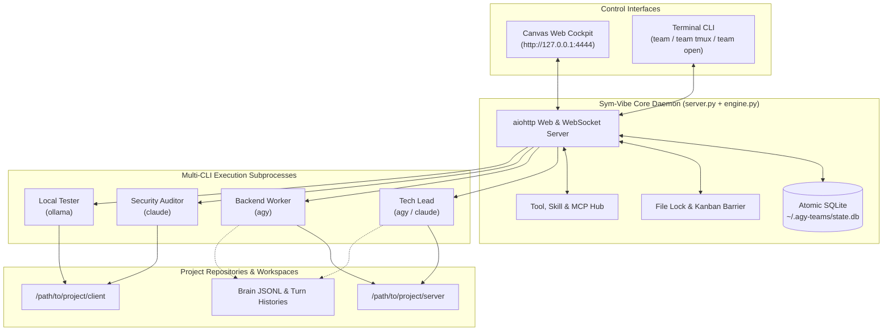

# 🚀 Sym-Vibe / AGY-Vibe

> **Autonomous Multi-CLI Agent Team Mission Control & Orchestrator**  
> Unified Real-Time Dark Cockpit & Terminal Control for **Google Antigravity (`agy`)**, **Anthropic Claude Code (`claude`)**, **Aider (`aider`)**, **Ollama**, and Custom Agents.

[](LICENSE)
[](https://python.org)
[](#)
[](#)

---

## ⚡ Overview

**Sym-Vibe** solves the friction of orchestrating multiple autonomous AI coding agents working on large-scale codebases. Instead of juggling dozens of terminal tabs or relying on brittle tmux capture scripts, Sym-Vibe provides:

1. **Multi-CLI Runtime Engine**: Run different CLI tools side-by-side in the same project team. For instance, assign your Backend agent to `agy`, your Architecture Lead to `claude`, your Refactor specialist to `aider`, and your local code assistant to `ollama`.
2. **Zero-Tmux Native Engine**: Autonomous background runners communicate with native process execution, persisting state atomically in SQLite and streaming pure structured Markdown, thinking tokens, and tool calls.
3. **Dual Mission Control**:
   - **Infinite Canvas Web Cockpit**: High-craft Obsidian/Amber industrial canvas with real-time reactive wires, agent status cards, quick-tool launchers, and Kanban boards.
   - **Interactive Terminal Mission Control**: Jump right into any agent's live interactive session (`team open @target`), launch a multi-pane tmux mission control (`team tmux`), or stream colored telemetry logs (`team watch`).
4. **Asynchronous Cross-Agent Messaging (`/btw`)**: Non-blocking out-of-band communication between agents and tech leads that prevents context deadlocks.
5. **Conflict & File Locking Barrier**: Real-time detection and visualization of file locks across repositories to prevent agents from clobbering each other's changes.

---

## 🧩 Supported CLI Runtimes

| Runtime | CLI Command | Interaction Mode | Features Supported |
| :--- | :--- | :--- | :--- |
| **Google Antigravity** | `agy` | Headless & Interactive | Full JSONL Brain telemetry, thinking process, MCP tools, Antigravity skills |
| **Anthropic Claude Code** | `claude` | Headless & Interactive | `--print`, `-p`, `--resume`, dangerous permissions skip, turn recording |
| **Aider** | `aider` | Headless & Interactive | Git-aware automated pair programming, multi-file edits |
| **Ollama** | `ollama` | Local LLM Headless | Fully offline, private models (`llama3.2`, `qwen2.5-coder`, `deepseek-coder`) |
| **Custom Script** | Shell script / binary | Headless | Reusable custom bots and CI validation pipelines |

---

## 🏗️ Architecture



---

## 📥 Installation

### Quick Install (Recommended)

Clone the repository and run the setup wizard:

```bash
git clone https://github.com/your-username/sym-vibe.git
cd sym-vibe
chmod +x install.sh
./install.sh
```

The installer will:
- Check for Python 3.9+ and install `aiohttp`.
- Detect your installed AI CLI tools (`agy`, `claude`, `aider`, `ollama`, `tmux`).
- Symlink the unified command `team` to `~/.local/bin/team`.
- Set up an automated, self-healing systemd user service (`agy-vibe.service`).

---

## 🚀 Quickstart & Usage

### 1. Launch Mission Control
Simply run:
```bash
team
```
This automatically starts the background orchestrator (if not already running), opens the visual Web UI in your browser, and displays the live status dashboard in your terminal.

### 2. View Active Agents
```bash
team agents [team-name]
```
Displays an organized terminal table showing agent IDs, target tags (`@tag`), CLI runtimes (`AGY`, `CLAUDE`, etc.), current statuses (`IDLE`, `WORKING`), conversation IDs, and bound tools.

### 3. Terminal Hacker Mode (Tmux Mission Control)
If you love having multiple terminal panes monitoring your AI agents live:
```bash
team tmux [team-name]
```
Launches an interactive, mouse-enabled tmux session with a dedicated window per agent, synchronized with the orchestrator.

### 4. Direct Interactive Jump-In
Need to manually guide an agent in full-screen terminal mode?
```bash
team open @backend
```
Instantly launches the agent's interactive CLI (resuming its exact conversation context and working directory).

### 5. Send Tasks & Asynchronous Notes
```bash
# Direct task assignment:
team dispatch anikuro @backend "Write comprehensive integration tests for auth routes."

# Non-blocking /btw note:
team note anikuro @backend "/btw reminder: use argon2 for password hashing"
```

### 6. Live Stream Telemetry
```bash
team watch [team-name] [target]
```
Follows the real-time stream of thoughts, tool executions, and markdown responses in high-contrast color.

---

## ⚙️ Configuration & Adding Agents

### Adding an Agent via CLI
```bash
team add-agent anikuro \
  --name "Security Auditor" \
  --role "OWASP Vulnerability Specialist" \
  --target "@security" \
  --runtime claude \
  --persona "security-auditor" \
  --effort high
```

### Adding an Agent via Web UI
Click **"+ Ajan Ekle"** in the top navigation bar. In the modal:
1. Enter Name and `@tag`.
2. Choose your **CLI Engine** (`agy`, `claude`, `aider`, `ollama`, `custom`).
3. Select optional Persona and Thinking Effort.
4. Set the dedicated workspace subdirectory.

---

## 🛠️ Tool & MCP Integration Hub

Sym-Vibe automatically indexes all native Antigravity skills, Chrome DevTools plugins, MCP servers, and custom bash tools registered in SQLite:
- Run one-off diagnostic commands (`git-status-diff`, `graphify-query`, `memory-sync`) directly from card header chips.
- Add reusable custom tools via the Web UI's Tool Hub drawer or via `POST /api/tool/create`.

---

## 🗑️ Uninstallation

To cleanly remove the service and symlinks:
```bash
./uninstall.sh
```
To purge all saved team states and SQLite databases as well:
```bash
./uninstall.sh --purge
```

---

## 📄 License

This project is open-source under the [MIT License](LICENSE).
