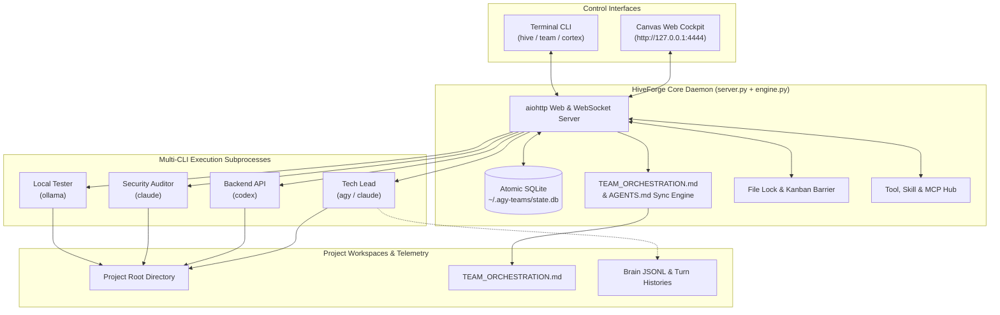

# 🐝 HiveForge

> **Autonomous Multi-CLI Agent Team Mission Control & Orchestrator**  
> Unified Real-Time Dark Cockpit & Terminal Control for **Google Antigravity (`agy`)**, **Anthropic Claude Code (`claude`)**, **OpenAI Codex (`codex`)**, **Aider (`aider`)**, **Ollama**, and Custom Agents.

[](LICENSE)
[](https://python.org)
[](#)
[](#)

---

## ⚡ Overview

**HiveForge** is an open-source, local-first mission control system that coordinates autonomous AI coding agents across multiple codebases. It bridges the gap between different AI CLI ecosystems, allowing teams composed of different LLM tools to collaborate seamlessly on shared repositories without deadlocks or clobbered edits.

### Key Capabilities

1. **Multi-CLI Runtime Engine**:
   - Mix and match agents powered by different engines in the same team:
     - **Google Antigravity (`agy`)**: Full JSONL Brain telemetry, thinking process, Antigravity skills.
     - **Anthropic Claude Code (`claude`)**: Direct terminal code execution, `--resume` turn continuity.
     - **OpenAI Codex (`codex`)**: ChatGPT-powered coding engine via OpenAI CLI.
     - **Aider (`aider`)**: Git-aware automated pair programming.
     - **Ollama**: Local offline LLM execution (`llama3.2`, `qwen2.5-coder`, `deepseek-coder`).
     - **Custom Scripts**: Any CLI tool or bash script template.
2. **Built-in Orchestration & Team Context Awareness**:
   - Every agent automatically knows about its teammates, their assigned roles, and communication rules.
   - Generates and synchronizes `TEAM_ORCHESTRATION.md` and `AGENTS.md` directly inside your project repository.
   - Dynamic prompt prefixing ensures that whichever CLI is used, the agent respects out-of-band communication (`/btw`) and file locks.
3. **Dual Mission Control**:
   - **Infinite Canvas Web Cockpit**: High-craft Obsidian/Amber industrial dark canvas with reactive wires, telemetry cards, tool execution chips, and Kanban boards.
   - **Interactive Terminal Mission Control**: Live multi-pane tmux mission control (`hive tmux`), single-agent interactive jump-in (`hive open @target`), and colorized telemetry streaming (`hive watch`).
4. **Asynchronous Cross-Agent Messaging (`/btw`)**:
   - Non-blocking out-of-band communication between agents and tech leads (`/btw @target [note]`) that prevents context deadlocks.
5. **Conflict & File Locking Barrier**:
   - Real-time monitoring and visual indicators for file locks (`.locks/locks.json`) across submodules.

---

## 🧩 Supported CLI Runtimes

| Runtime | CLI Command | Interaction Mode | Capabilities |
| :--- | :--- | :--- | :--- |
| **Google Antigravity** | `agy` | Headless & Interactive | Full JSONL Brain telemetry, thinking process, MCP tools, Antigravity skills |
| **Anthropic Claude Code** | `claude` | Headless & Interactive | `--print`, `-p`, `--resume`, permissions bypass, SQLite turn recording |
| **OpenAI Codex** | `codex` | Headless & Interactive | ChatGPT coding engine, multi-file code synthesis |
| **Aider** | `aider` | Headless & Interactive | Git-aware automated pair programming, multi-file edits |
| **Ollama** | `ollama` | Local LLM Headless | Fully offline, private models (`llama3.2`, `qwen2.5-coder`) |
| **Custom Script** | Shell command | Headless | Reusable custom bots and CI validation pipelines |

---

## 🏗️ Architecture



---

## 📥 OS-Aware Installation

Clone the repository and run the universal installer:

```bash
git clone https://github.com/ElCunq/HiveForge.git
cd HiveForge
chmod +x install.sh
./install.sh
```

### What the Installer Does:
- **Automatic OS Detection**: Supports Arch Linux, Debian/Ubuntu, Fedora/RHEL, openSUSE, Alpine, WSL, and macOS (Darwin / Apple Silicon & Intel).
- **Tool Environment Scan**: Checks for `agy`, `claude`, `codex`, `aider`, `ollama`, and `tmux`.
- **System Service Configuration**:
  - **Linux**: Creates and starts a self-healing `systemd` user service (`hiveforge.service`).
  - **macOS**: Configures a native `launchd` LaunchAgent (`com.hiveforge.orchestrator.plist`).
  - **WSL / Non-Systemd**: Provides standalone daemon support.
- **Unified CLI Linking**: Symlinks `hive`, `team`, and `cortex` into `~/.local/bin/`.

---

## 🚀 Quickstart & Usage

### 1. Launch Mission Control
```bash
hive
# or: team
```
Opens the web cockpit in your default browser and displays the live status dashboard in your terminal.

### 2. View Active Agents & Runtimes
```bash
hive agents [team-name]
```
Outputs an organized terminal table showing agent targets (`@tag`), CLI runtimes (`AGY`, `CLAUDE`, `CODEX`, etc.), statuses (`IDLE`, `WORKING`), conversation IDs, and bound tools.

### 3. Terminal Hacker Mode (Tmux Mission Control)
```bash
hive tmux [team-name]
```
Launches an interactive, mouse-enabled tmux session with a dedicated window per agent, synchronized with the orchestrator.

### 4. Direct Interactive Jump-In
Need to manually take over an agent in full-screen terminal mode?
```bash
hive open @backend
```
Instantly launches the agent's interactive CLI (resuming its exact conversation context and working directory).

### 5. Send Tasks & Asynchronous Notes
```bash
# Direct task assignment:
hive dispatch anikuro @backend "Implement JWT rotation in auth middleware."

# Non-blocking /btw note:
hive note anikuro @backend "/btw reminder: use Argon2id for password hashes"
```

### 6. Live Stream Telemetry
```bash
hive watch [team-name] [target]
```
Streams thoughts, tool calls, and markdown outputs in high-contrast color.

---

## 👥 Team Context Awareness

When you run agents with HiveForge, every agent is automatically context-aware:
1. **Dynamic turn context** is injected so the LLM knows its identity, teammates, and the `/btw` communication protocol.
2. A persistent **`TEAM_ORCHESTRATION.md`** and **`AGENTS.md`** are automatically maintained in the project directory with current roles and guidelines.

---

## 🗑️ Uninstallation

```bash
./uninstall.sh
```
To also purge saved databases and configurations:
```bash
./uninstall.sh --purge
```

---

## 📄 License

This project is open-source under the [MIT License](LICENSE).
